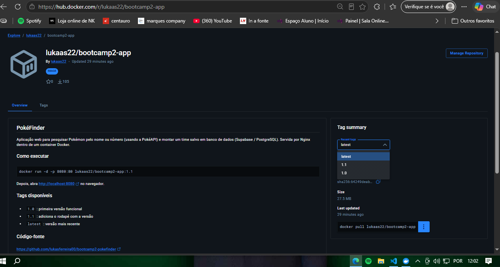
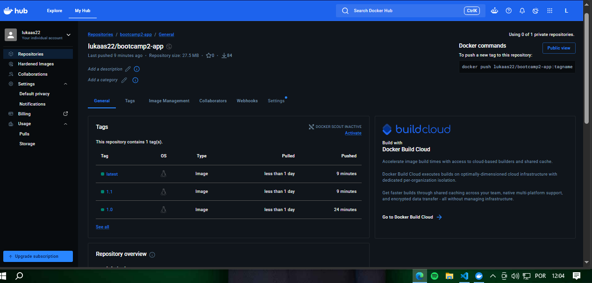

# ⚡ PokéFinder

Aplicação web para pesquisar Pokémon pelo nome ou número (usando a PokéAPI) e montar um **time de Pokémon salvo em banco de dados real**. Na Etapa 02, a aplicação ganhou persistência com Supabase e foi empacotada em uma imagem Docker publicada no Docker Hub.

## Links

- **Repositório no GitHub:** https://github.com/lukasferreira00/bootcamp2-pokefinder
- **Aplicação no GitHub Pages:** https://lukasferreira00.github.io/bootcamp2-pokefinder/
- **Repositório no Docker Hub:** https://hub.docker.com/r/lukaas22/bootcamp2-app

## Como executar com Docker

Com o Docker instalado, rode uma única linha:

```bash
docker run -d -p 8080:80 lukaas22/bootcamp2-app:1.1
```

Depois, abra http://localhost:8080 no navegador.

## Funcionalidades

- Busca de Pokémon por nome ou número.
- Exibição da imagem, tipo, altura, peso e número do Pokémon.
- Mensagem de erro para Pokémon não encontrado.
- **Meu time:** adicionar o Pokémon pesquisado ao time, listar o time salvo e remover Pokémon do time.

## Persistência de dados

- **Banco escolhido:** Supabase (PostgreSQL), acessado direto do frontend pela biblioteca `supabase-js`.
- **O que é salvo:** os Pokémon que o usuário adiciona ao seu time. Os dados ficam no banco e continuam lá depois de fechar o navegador.
- **Operações:** criar (botão "Adicionar ao time"), listar (seção "Meu time", carregada ao abrir a página) e excluir (botão "Remover").

**Estrutura da tabela `favorito`:**

| Coluna | Tipo | Descrição |
|---|---|---|
| `id` | int8 (identity) | Identificador do registro |
| `created_at` | timestamptz | Data e hora em que foi salvo |
| `pokemon_id` | int | Número do Pokémon na Pokédex |
| `nome` | text | Nome do Pokémon |
| `imagem` | text | Endereço da imagem do Pokémon |
| `tipos` | text | Tipos do Pokémon (ex.: electric) |

**Limitação conhecida:** as políticas de acesso (RLS) da tabela estão abertas para a chave pública (`anon`), permitindo ler, inserir e excluir. Isso é aceitável nesta etapa, mas não é seguro para produção: qualquer pessoa com acesso ao site pode alterar o time. Uma versão futura deveria usar autenticação de usuários.

## Docker

O `Dockerfile` usa a imagem `nginx:alpine` para servir os arquivos `index.html`, `style.css` e `script.js`.

Para construir e rodar localmente:

```bash
docker build -t bootcamp2-app .
docker run -d -p 8080:80 --name meu-app bootcamp2-app
```

## Evidências das sidequests

### SQ1 · .dockerignore

O arquivo `.dockerignore` exclui `.git`, `.gitignore`, `README.md`, `Dockerfile`, `.dockerignore` e a pasta `prints`.

Antes de construir a imagem, o Docker envia ao servidor de build todos os arquivos da pasta (o "contexto de build"). Com o `.dockerignore`, arquivos que a aplicação não precisa, como o histórico do Git e as imagens dos prints, não são enviados. O contexto fica menor, o build é mais rápido e a imagem não corre o risco de carregar arquivos desnecessários caso o `Dockerfile` passe a copiar a pasta inteira.

### SQ2 · Versionamento de imagem

Foram publicadas três tags no Docker Hub: `1.0` (primeira versão funcional), `1.1` (adiciona o rodapé com a versão) e `latest`.



### SQ3 · Descrição no Docker Hub

O overview do repositório descreve a aplicação, traz o comando `docker run` pronto para copiar e o link do repositório no GitHub.



### SQ4 · Explorando a orquestração

Dois containers da mesma imagem rodando ao mesmo tempo, nas portas 8080 e 8081:

```bash
docker run -d -p 8080:80 --name meu-app bootcamp2-app
docker run -d -p 8081:80 --name meu-app2 lukaas22/bootcamp2-app:1.1
```


**E se eu tivesse 100 containers, como gerenciaria?**

Subir e acompanhar 100 containers na mão, um `docker run` de cada vez, seria inviável: seria preciso decidir em qual máquina cada um roda, reiniciar os que caem e distribuir o acesso entre eles. É para isso que existe o Kubernetes, uma ferramenta de orquestração de containers. Ele trabalha com um **cluster**, que é um conjunto de máquinas (nós) gerenciadas como se fossem um único sistema. A menor unidade que ele executa é o **pod**, que agrupa um ou mais containers. Para garantir disponibilidade, define-se o número de **réplicas**, ou seja, quantas cópias do mesmo pod devem estar rodando. O Kubernetes mantém esse número: se um pod cair, cria outro automaticamente, e também permite aumentar ou diminuir as réplicas conforme a demanda e distribuir o tráfego entre elas.

## Autor

Lukas Ferreira de Souza, estudante de Análise e Desenvolvimento de Sistemas.